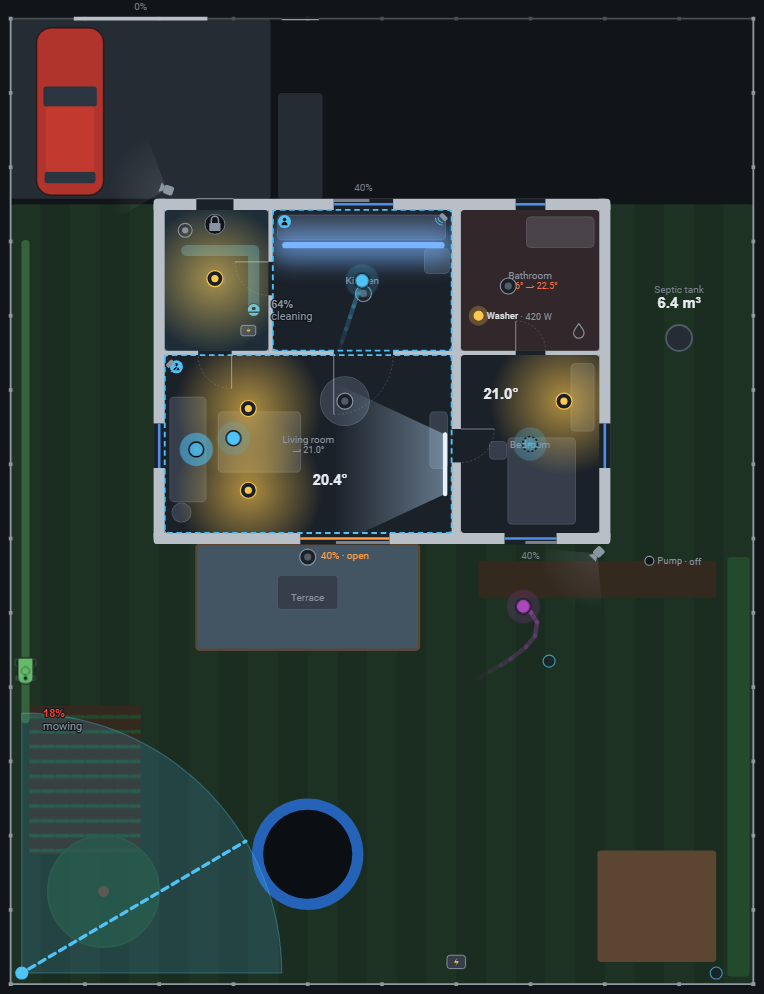
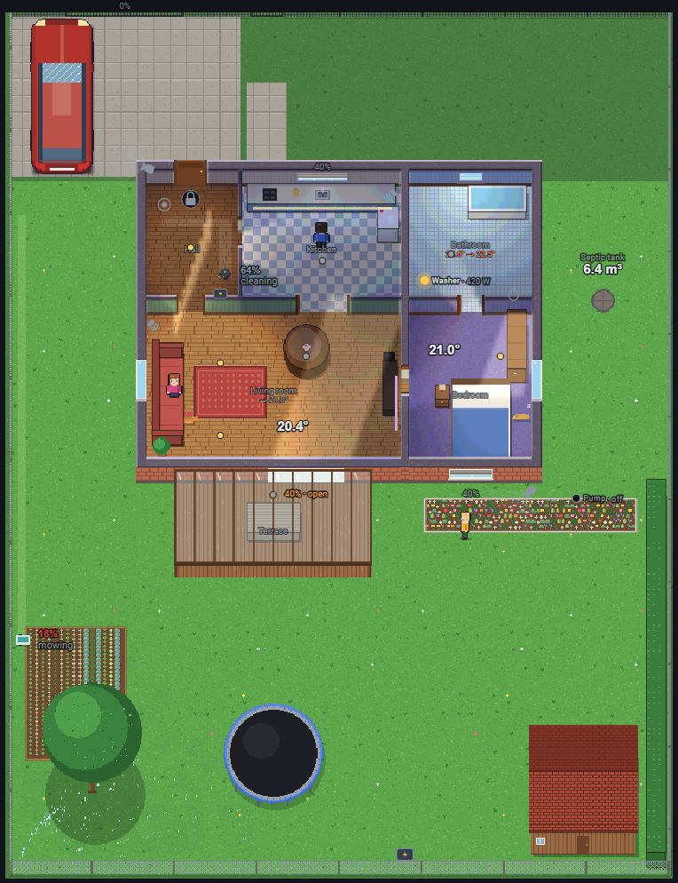
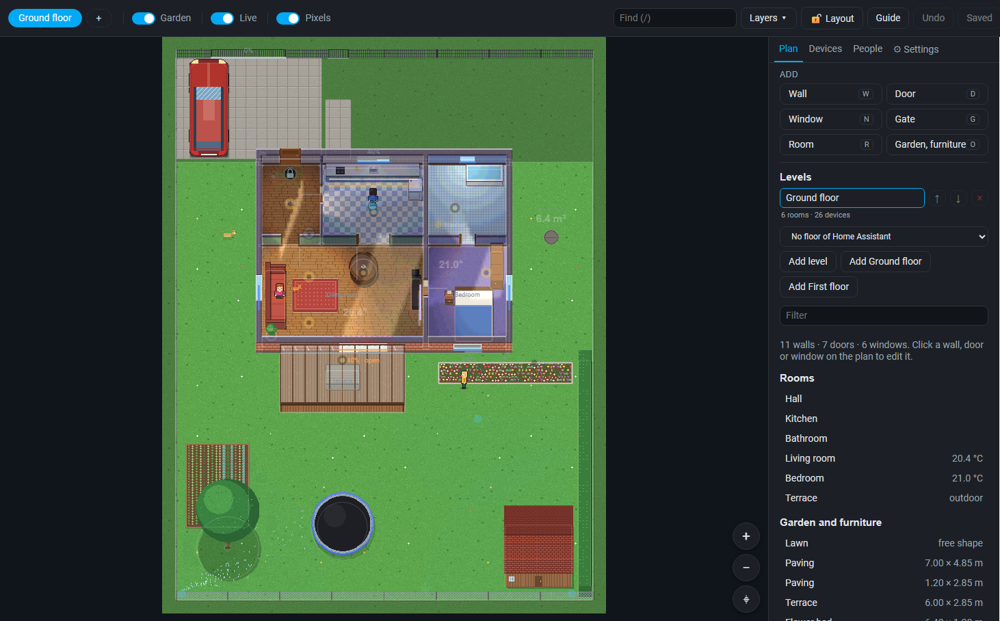
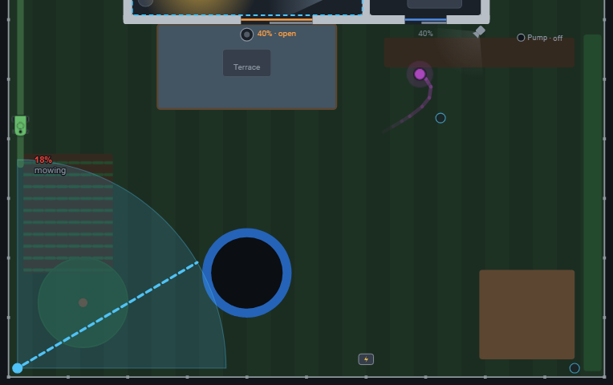
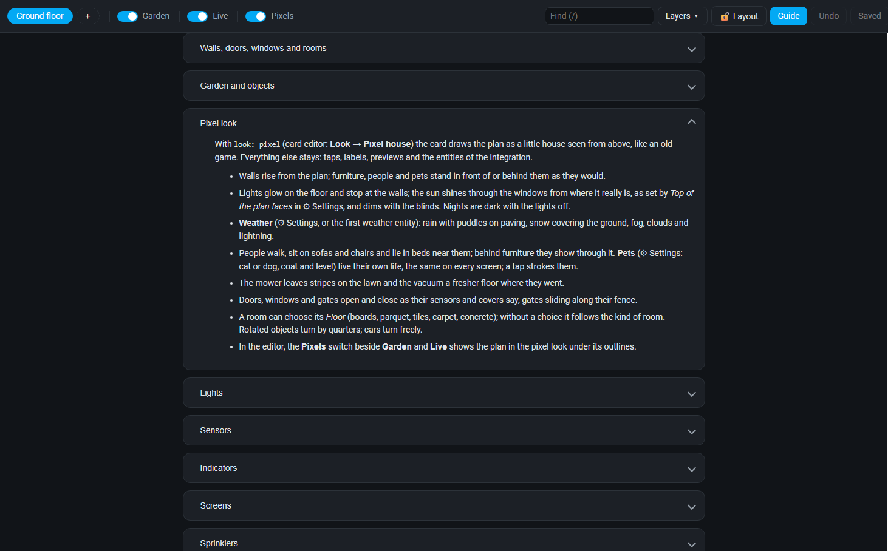

<p align="center">
  
</p>

<p align="center">
  A live 2D floor plan for Home Assistant: draw your home once, then see and control lights, blinds, sensors, people, robots and cameras on one map.
</p>

<p align="center">
  <a href="https://github.com/Holczyns/floorcast/actions/workflows/validate.yml"></a>
  <a href="https://github.com/Holczyns/floorcast/actions/workflows/tests.yml"></a>
  <a href="https://hacs.xyz"></a>
  <a href="https://github.com/Holczyns/floorcast/blob/main/LICENSE"></a>
</p>

FloorCast shows your home as it is right now. You draw the plan once in a Home Assistant panel: walls, doors,
windows, rooms, the garden and the devices where they really are. Every dashboard then shows it alive: lights glow
in their colour and stop at the walls, windows open and blinds close, temperatures stand in their rooms, people
walk from room to room, the mower crosses the lawn and the sprinklers throw water while they run.

The plan is not only to look at. A tap on a room switches its lights, a tap on a window moves its blind, a tap on a
camera opens what it sees. People counted on the plan become entities for your automations, so a light can follow
someone to the kitchen counter.

## One switch, and your home moves into a retro world

<table>
  <tr>
    <td width="50%"></td>
    <td width="50%"></td>
  </tr>
  <tr>
    <td align="center"><b>Plan</b>: clear and exact</td>
    <td align="center"><b>Pixel house</b>: the same home, alive like an old game</td>
  </tr>
</table>

You draw nothing twice. Set **Look → Pixel house** in the card editor, or one line in YAML, and the very same plan
becomes a little house seen from above:

```yaml
type: custom:floorcast-card
look: pixel
```

Walls rise from your plan, furniture stands where you drew it, lamps light up the floor, the sun shines through the
windows from where it really is and nights get dark. The weather of Home Assistant brings rain with puddles, snow, fog
and lightning. People walk, sit on the sofa and lie in bed, your cat and dog wander around, the car leaves the
driveway when you do, the gate slides open and the mower leaves stripes on the lawn. Every tap, label and entity works
just as on the plan, so you can switch back and forth at any time, or show one look on the phone and the other on the
wall panel.

**[Try the demo](https://holczyns.github.io/floorcast/)**: the card and the editor with an example house, in your browser.
Switch between the plan and the pixel house, show or hide the garden, change the weather and the time of day, and try
the lights, blinds, gate, car, sprinklers, a visitor at the door or a water leak.

## Features

### Draw

- **Plan editor** in the sidebar: walls with wall types, doors, windows, rooms, several levels, garden objects and
  furniture, with snapping, typed wall lengths, undo, import and export.
- **Rooms linked to areas** and levels to floors: a room offers the lights, sensors, blinds and contacts of its Home
  Assistant area, and **Place all** puts them in at once.
- **Furniture and garden**: more than thirty kinds of furniture drawn by their size and shape (an armchair, a corner
  sofa, a corner kitchen), with a colour and the side of their back; lawns, paving, beds, hedges, trees, a greenhouse,
  a garden house and shelters with a slatted or polycarbonate roof.
- **Fences** as a kind of wall in six styles (pickets, boards, metal panels, wire mesh, brick, gabion) with driveway
  gates and wickets.
- **Cars** with a body, colour and direction, shown while their presence entity is home and leaving a faint shadow on
  their parking place otherwise.
- **Pets**: a cat, a dog, a rabbit or a tiger, each living its own life on the card, the same on every screen:
  sleeping, washing, hunting, fetching, hopping, and rolling over when stroked.
- **Built-in guide** in the editor, explaining every part with examples.

### See

- **Dashboard card** that draws the saved plan with live states and follows every save. It fits phones, tablets and
  wall panels, with levels side by side or in tabs and an optional crop. Zoom and pan on the dashboard can be allowed;
  levels side by side move as one picture, past the crop as far as their drawings reach, and the card starts from its
  default view each time. Its background can be the plan's, the theme's or transparent.
- **Two looks**, the plan and the pixel house, switched with one option.
- **Lights** as points or strips, glowing in their colour and brightness.
- **Doors, windows and blinds** following their contact sensors and covers.
- **Sensors** written where they stand: a header, the main value and up to two secondary values.
- **Thermostats**: the target under the room name, the room glowing while it heats or cools.
- **Indicators**: any entity as a dot with its state that glows while the device runs, such as a washer by its power
  or a pump by its switch.
- **Mower and vacuum** placed on the plan from their maps, with their tracks and battery.
- **Camera stills** beside the camera, refreshed while shown, opening by themselves and turning the view red when the
  camera's person or motion sensor sees someone.
- **Ground view** (experimental): the camera image laid on the plan, also ahead of the moving mower.
- **Alarms**: smoke, gas, carbon monoxide and water sensors pulse their room red and name it at the top of the card.
- **Heat map**: rooms coloured by temperature, humidity or CO₂, with a switch on the card.
- **Dark and light**: the plan follows the theme of Home Assistant, and every colour can be changed in the editor.

### Control

- **Taps**: a room switches all its lights, a window moves its blind, a screen (projector, TV) switches on and offers a
  remote control, a sprinkler opens or closes its valve.
- **Gates, garage doors and door locks** that open, close, lock and unlock on a tap after a question.
- **Ask before switching** for a pump, a server or a gate.
- **Service `floorcast.press`** doing what a tap does, for automations and buttons.
- **Child lock** on a card: a tap only switches lights, with no blinds, gates, locks, devices or details of Home
  Assistant.

### Play

- **Full screen** button on the card: the plan alone on the whole screen, filling it, moved with one finger.
- **Walking game**: on the whole screen a character with a marker walks the home with a joystick or the arrow keys,
  stops at walls and furniture, strokes the pets and switches real lights with its action button.

- **Lamp game** for children: one of the chosen lamps lights up, whoever runs to it puts it out, and after a moment in
  the dark the next one lights up. Radars and cameras see who comes; the card has Start and Stop, rings the lit lamp
  and shows the score and the end. Points to win and the lamps are set in the plan; two minutes without a hit end it.

### Count

- **People** from HLK-LD2450 radars and Frigate cameras, joined by one tracker, with entrance, ignore and resting place
  zones and the paths they walked during the last day.
- **Counting**: a count and an occupancy entity for every room and counting zone, ready for automations; motion and
  presence sensors keep a room occupied too.

### Everywhere

- **English and Polish**, as each user's language in Home Assistant or one chosen for the plan; more languages can be
  added.
- **Local**: everything is computed inside Home Assistant, the card only draws. No extra Python packages, no
  resources to add by hand.







## Requirements

- Home Assistant 2026.10 or newer.
- Lights, covers, contact and other sensors, valves: any integration.
- Optional, for people: HLK-LD2450 radars through ESPHome, Frigate cameras with the Frigate integration, or both.
- Optional, for robots: a Dreame or MOVA mower through the
  [Dreame Lawn Mower](https://github.com/EvotecIT/homeassistant-dreamelawnmower) integration, a Roborock vacuum through
  the Roborock integration.

Tested with an HLK-LD2450 on an ESP32-C3 (ESPHome 2026.10), Frigate 0.17 (integration 5.15.6), a MOVA ViAX 250
(Dreame Lawn Mower 0.2.182) and a Roborock Qrevo 5AE.

## Installation

### HACS

[](https://my.home-assistant.io/redirect/hacs_repository/?owner=Holczyns&repository=floorcast&category=integration)

1. Click the button above, or in HACS open the menu in the top right corner, choose **Custom repositories** and add
   `https://github.com/Holczyns/floorcast` with the type **Integration**.
2. Download **FloorCast** and restart Home Assistant.
3. Add the integration:

   [](https://my.home-assistant.io/redirect/config_flow_start/?domain=floorcast)

   or **Settings → Devices & services → Add integration → FloorCast**.

### Manual

Copy `custom_components/floorcast` into the `custom_components` folder of your Home Assistant configuration, restart
Home Assistant and add the integration as in step 3.

## Getting started

1. Open **FloorCast** in the sidebar and draw the walls, doors, windows and rooms.
2. Choose the Home Assistant area of each room and press **Place all**: its lights, sensors, blinds and contacts appear
   in the room. Drag them where they are, place the rest by hand, and add radars, cameras and zones to count people.
3. Press **Save**.
4. Add the card to a dashboard: **Edit dashboard → Add card → FloorCast**.

**Guide** in the top bar of the editor explains every part, from drawing walls to calibrating cameras and setting up
the radar firmware.

## Entities and service

Every room a radar or a calibrated camera sees, and every counting zone, gets:

| Entity | State |
|---|---|
| `sensor.floorcast_<level id>_<room id>_count` | People counted there |
| `binary_sensor.floorcast_<level id>_<room id>_occupancy` | On while someone is counted there and for the hold time after |

A room with presence sensors (motion, occupancy, presence) also gets the occupancy entity, without a radar too; it
does not get a count. The `sources` attribute names what occupies the room now: `radar`, `camera` or `sensor`.

With the lamp game on in the plan, `switch.floorcast_game` starts and stops it; its attributes give the lit lamp
(`target`), the `score`, the `goal` and how the last game ended (`result`: `won`, `timeout` or `stopped`).

Search for *FloorCast* in **Settings → Entities** to find them. `floorcast.press` does what a tap on the plan does,
for a `room`, an `opening` or a `device` given by its id.

## How it works

```
radars ─┐                                        ┌─► count and occupancy entities
         ├─► rules ─► tracker ─► rooms and zones ─┤
Frigate ─┘                                        └─► cards (people, trails)

mower map, vacuum position ─► robots ─► cards (place, track)
camera images ─► stills (and ground views) ─► cards
plan (saved by the editor) ─► everything above and every card
```

The plan is one JSON document in `.storage/floorcast.plan`, part of every Home Assistant backup. The tracking model
lives in `custom_components/floorcast/engine` without Home Assistant imports and is tested on its own.

## Development

```bash
# integration tests, Python 3.14 with pytest-homeassistant-custom-component
python -m pytest
ruff check . && ruff format --check .

# frontend
cd frontend && npm ci && npm run check && npm run build
```

The built card and panel in `custom_components/floorcast/www` are committed, so installing through HACS needs no build
step. `python tools/dev_server.py` serves `tools/harness.html` on port 8765: the card and the editor against a mocked
Home Assistant with the example house.

Translations live in `frontend/src/i18n`: a language is a folder with `card.ts` and `editor.ts` (English text →
translation) and `guide.ts`, registered in `card-languages.ts`, `editor-languages.ts`, `guide.ts` and `LANGUAGE_NAMES`.
`npm run i18n` lists the texts a language does not translate yet.

Issues and pull requests are welcome. Contributions are accepted under the MIT license of the project.

## License

[MIT](https://github.com/Holczyns/floorcast/blob/main/LICENSE). Code published before 5 November 2026, release 0.1.0 included, was licensed under GPL-3.0.

The built card and editor in `custom_components/floorcast/www` include [Lit](https://lit.dev), Copyright Google LLC,
under the BSD-3-Clause license; its notices are kept in the built files.
