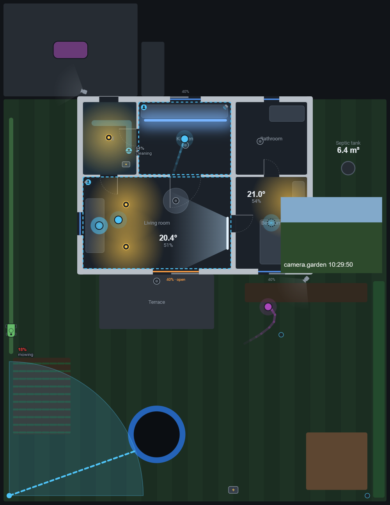
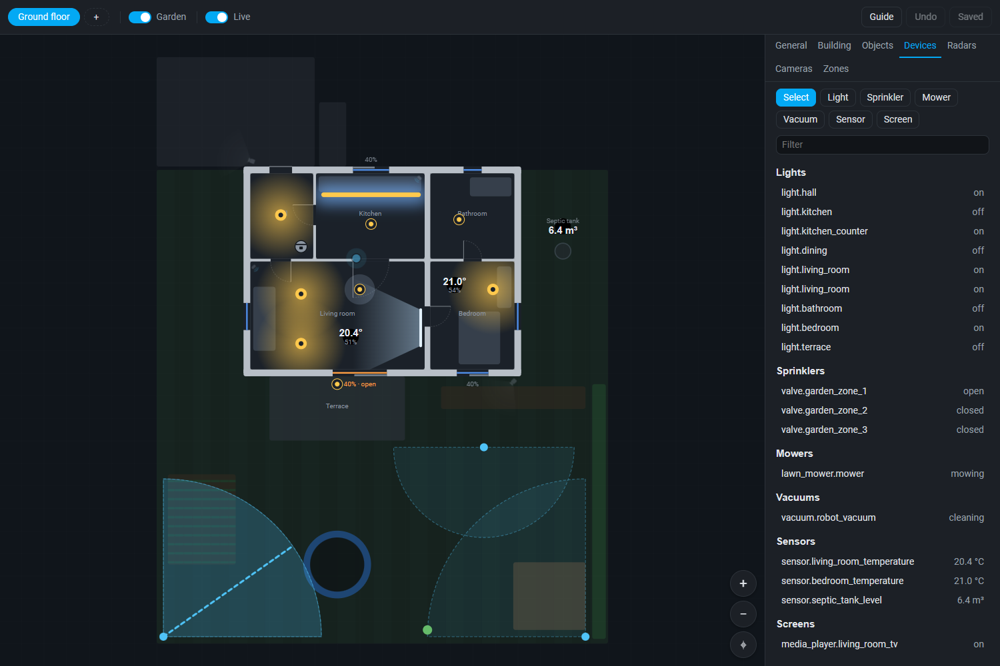
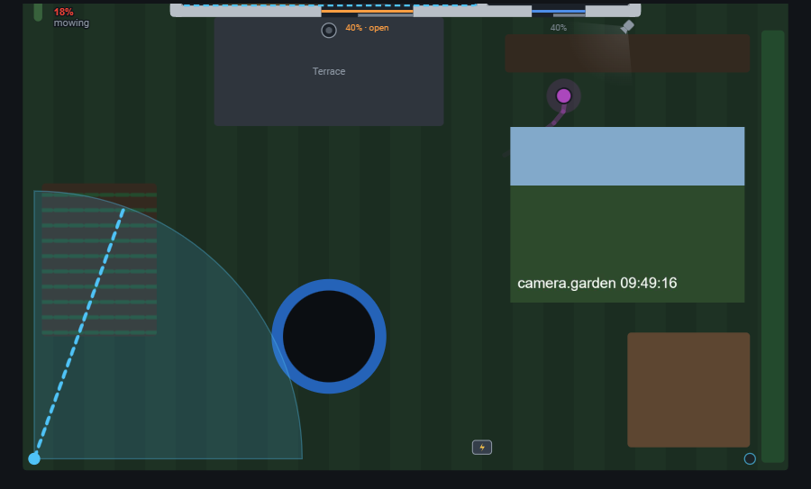
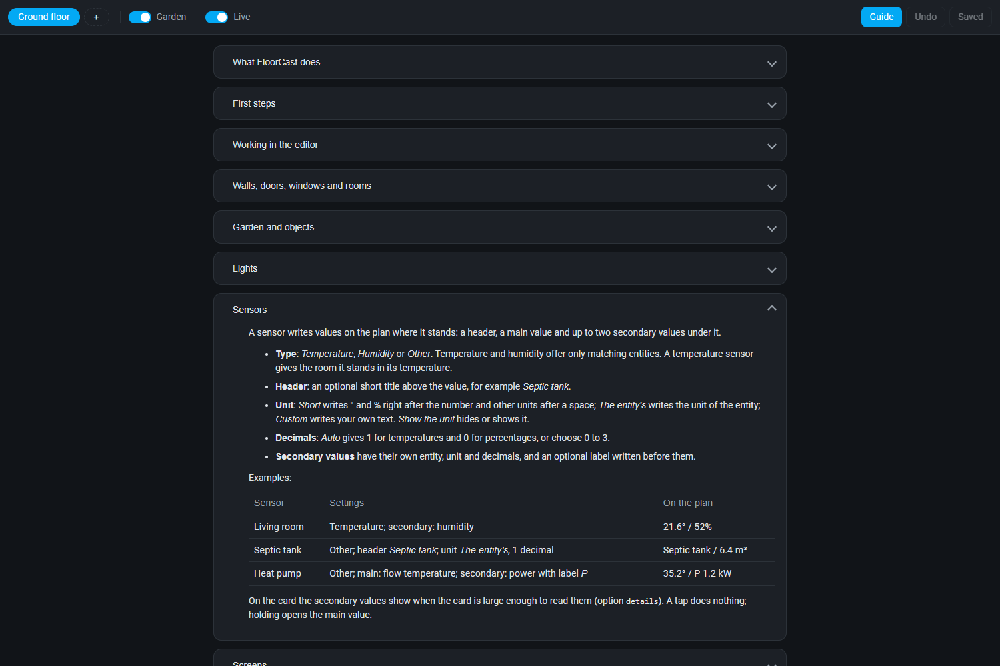

<p align="center">
  
</p>

<p align="center">
  A live 2D floor plan for Home Assistant: draw your home once, then see and control lights, blinds, sensors, people, robots and cameras on one map.
</p>

<p align="center">
  <a href="https://github.com/Holczyns/floorcast/actions/workflows/validate.yml"></a>
  <a href="https://github.com/Holczyns/floorcast/actions/workflows/tests.yml"></a>
  <a href="https://hacs.xyz"></a>
  <a href="LICENSE"></a>
</p>

FloorCast shows your home as it is right now. You draw the plan once in a Home Assistant panel: walls, doors,
windows, rooms, the garden and the devices where they really are. Every dashboard then shows it alive: lights glow
in their colour and stop at the walls, windows open and blinds close, temperatures stand in their rooms, people
walk from room to room, the mower crosses the lawn and the sprinklers throw water while they run.

The plan is not only to look at. A tap on a room switches its lights, a tap on a window moves its blind, a tap on a
camera opens what it sees. People counted on the plan become entities for your automations, so a light can follow
someone to the kitchen counter.



## Features

- **Plan editor** in the sidebar: walls with wall types, doors, windows, rooms, several levels, garden objects and
  furniture, with snapping, typed wall lengths, undo, import and export.
- **Dashboard card** that draws the saved plan with live states and follows every save. It fits phones, tablets and
  wall panels, with levels side by side or in tabs and an optional crop.
- **Lights** as points or strips, glowing in their colour and brightness; a tap on a room switches all its lights.
- **Doors, windows and blinds** following their contact sensors and covers.
- **Sensors** written where they stand: a header, the main value and up to two secondary values.
- **Screens** (projector, TV) with the light they throw and a remote control on the card.
- **Sprinklers** with their throw and arc, showing the water while the valve is open.
- **People** from HLK-LD2450 radars and Frigate cameras, joined by one tracker, with entrance, ignore and resting place
  zones and the paths they walked during the last day.
- **Counting**: a count and an occupancy entity for every room and counting zone, ready for automations.
- **Mower and vacuum** placed on the plan from their maps, with their tracks and battery.
- **Camera stills** beside the camera, refreshed while shown, opening by themselves when someone is seen.
- **Ground view** (experimental): the camera image laid on the plan, also ahead of the moving mower.
- **Built-in guide** in the editor, explaining every part with examples.
- **Service `floorcast.press`** doing what a tap does, for automations and buttons.
- **Local**: everything is computed inside Home Assistant, the card only draws. No extra Python packages, no
  resources to add by hand.







## Requirements

- Home Assistant 2026.10 or newer.
- Lights, covers, contact and other sensors, valves: any integration.
- Optional, for people: HLK-LD2450 radars through ESPHome, Frigate cameras with the Frigate integration, or both.
- Optional, for robots: a Dreame or MOVA mower through the
  [Dreame Lawn Mower](https://github.com/EvotecIT/homeassistant-dreamelawnmower) integration, a Roborock vacuum through
  the Roborock integration.

Tested with an HLK-LD2450 on an ESP32-C3 (ESPHome 2026.10), Frigate 0.17 (integration 5.15.6), a MOVA ViAX 250
(Dreame Lawn Mower 0.2.182) and a Roborock Qrevo 5AE.

## Installation

### HACS

1. In HACS, open the menu in the top right corner and choose **Custom repositories**.
2. Add `https://github.com/Holczyns/floorcast` with the type **Integration**.
3. Search for **FloorCast**, download it and restart Home Assistant.
4. Go to **Settings → Devices & services → Add integration** and choose **FloorCast**.

### Manual

Copy `custom_components/floorcast` into the `custom_components` folder of your Home Assistant configuration, restart
Home Assistant and add the integration as in step 4.

## Getting started

1. Open **FloorCast** in the sidebar and draw the walls, doors, windows and rooms.
2. Place the devices and choose their entities; add radars, cameras and zones to count people.
3. Press **Save**.
4. Add the card to a dashboard: **Edit dashboard → Add card → FloorCast**.

**Guide** in the top bar of the editor explains every part, from drawing walls to calibrating cameras and setting up
the radar firmware.

## Entities and service

Every room a radar or a calibrated camera sees, and every counting zone, gets:

| Entity | State |
|---|---|
| `sensor.floorcast_<level id>_<room id>_count` | People counted there |
| `binary_sensor.floorcast_<level id>_<room id>_occupancy` | On while someone is counted there and for the hold time after |

Search for *FloorCast* in **Settings → Entities** to find them. `floorcast.press` does what a tap on the plan does,
for a `room`, an `opening` or a `device` given by its id.

## How it works

```
radars ─┐                                        ┌─► count and occupancy entities
         ├─► rules ─► tracker ─► rooms and zones ─┤
Frigate ─┘                                        └─► cards (people, trails)

mower map, vacuum position ─► robots ─► cards (place, track)
camera images ─► stills (and ground views) ─► cards
plan (saved by the editor) ─► everything above and every card
```

The plan is one JSON document in `.storage/floorcast.plan`, part of every Home Assistant backup. The tracking model
lives in `custom_components/floorcast/engine` without Home Assistant imports and is tested on its own.

## Development

```bash
# integration tests, Python 3.14 with pytest-homeassistant-custom-component
python -m pytest
ruff check . && ruff format --check .

# frontend
cd frontend && npm ci && npm run check && npm run build
```

The built card and panel in `custom_components/floorcast/www` are committed, so installing through HACS needs no build
step. `python tools/dev_server.py` serves `tools/harness.html` on port 8765: the card and the editor against a mocked
Home Assistant with the example house.

Issues and pull requests are welcome. By opening a pull request you agree to the contribution terms in
[NOTICE](NOTICE).

## License

[GPL-3.0](LICENSE) with additional terms in [NOTICE](NOTICE): a changed copy must use a different name and logo and
say "Based on FloorCast by Michal Holowko".
